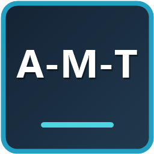
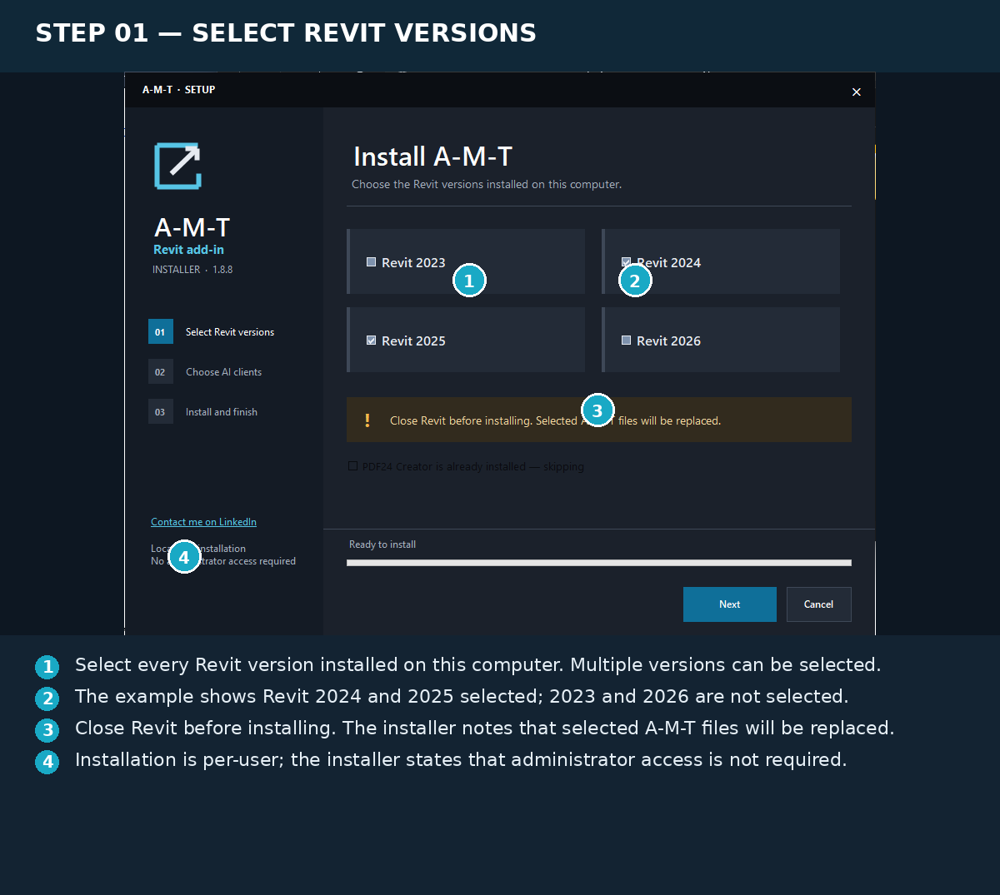
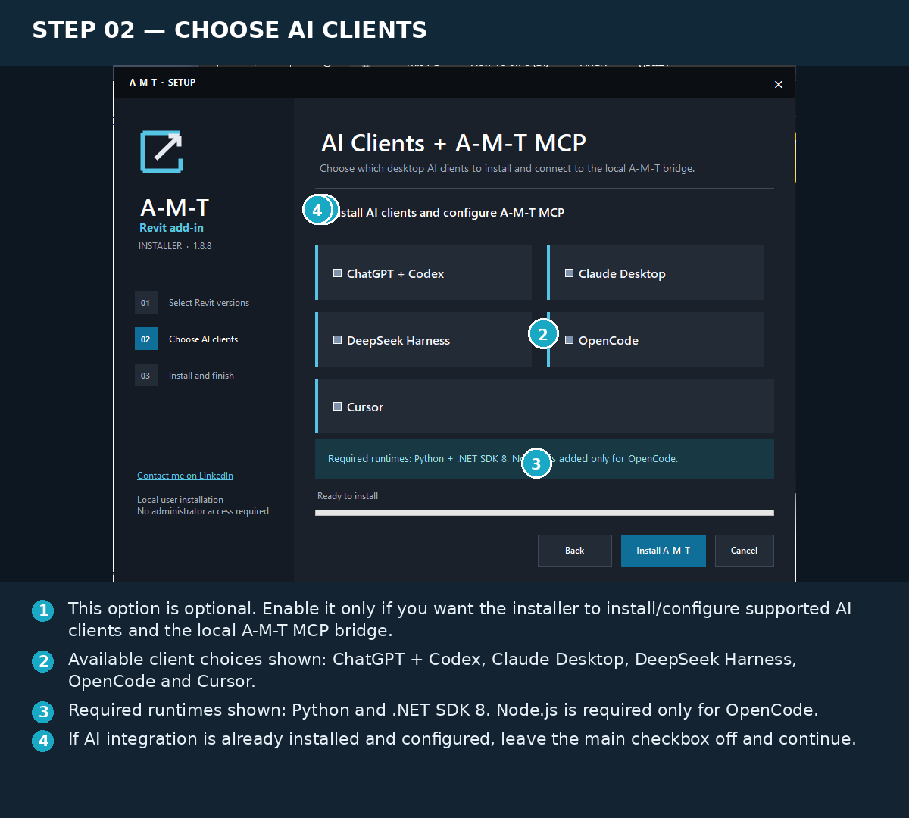
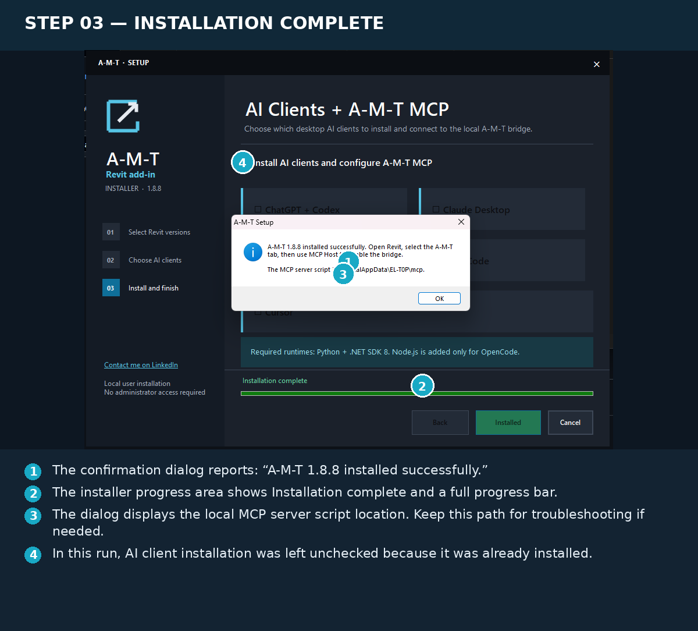
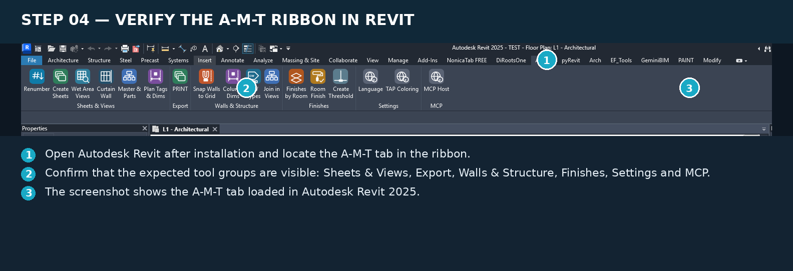

  

<h1 align="center">A-M-T Installation Guide</h1>

  <b>Architectural Modeling Toolkit</b> 
  Installation & Setup Guide — Version 1.8.8

  <a href="AMT_1.8.8_Installation_Guide_Annotated.pdf">
    Download Illustrated PDF Guide
  </a>

---

## Overview

This guide explains how to install A-M-T, select Revit versions, configure optional AI integrations, and verify successful installation.

## Step 01 — Select Revit Versions

Choose the Revit versions installed on your computer.

**Important Notes:**
- Multiple Revit versions can be selected.
- Supported installer options shown: Revit 2023, 2024, 2025 and 2026.
- Close Revit before installing.
- Installation is performed for the current user.
- Administrator access is not required.

---

## Step 02 — Choose AI Clients

A-M-T provides an optional AI integration setup through its local MCP bridge.

**Available AI Clients:**
- ChatGPT + Codex
- Claude Desktop
- DeepSeek Harness
- OpenCode
- Cursor

**Required Runtimes:**
- Python
- .NET SDK 8
- Node.js (OpenCode only)

**Important:**

AI integration is optional.

If AI integration is already installed and configured, leave the main checkbox disabled and continue.

---

## Step 03 — Installation Complete

After selecting the required options, start the installation.

A successful installation displays the confirmation message:

**A-M-T 1.8.8 installed successfully.**

The installer also displays the local MCP server script location.

---

## Step 04 — Verify Installation in Revit

Launch Autodesk Revit and locate the A-M-T tab in the ribbon.

Verify that the A-M-T tools are visible.

**Available Tool Groups:**
- Sheets & Views
- Export
- Walls & Structure
- Finishes
- Settings
- MCP

The screenshot demonstrates A-M-T running inside Autodesk Revit 2025.

---

## Troubleshooting

If A-M-T does not appear after installation:

1. Restart Autodesk Revit.
2. Verify that installation completed successfully.
3. Check the selected Revit version.
4. Contact the developer if the issue persists.

---

## Download

**Latest Version: A-M-T 1.8.8**

- [Download Latest Release](https://github.com/abdallahmostafataha6-blip/A-M-T/releases/latest)
- [Download Illustrated Installation PDF](AMT_1.8.8_Installation_Guide_Annotated.pdf)
- [Explore Individual Command Guides](Command-Guides/)

---

## Developer

**Abdallah Mostafa**

Architectural Engineer | BIM Architect | Revit & Dynamo Automation

[LinkedIn — Connect with me](https://www.linkedin.com/in/abdallah-m0stafa/)

[GitHub — A-M-T Repository](https://github.com/abdallahmostafataha6-blip/A-M-T)

---

  <b>A-M-T — Model. Document. Automate.</b>

