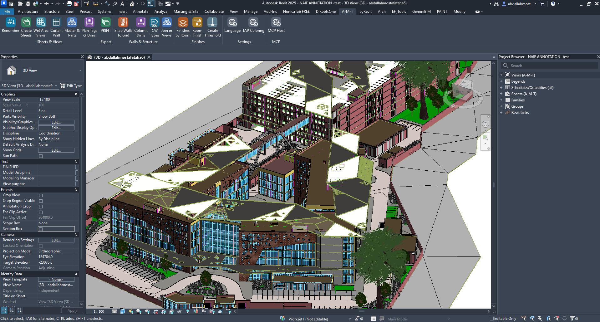
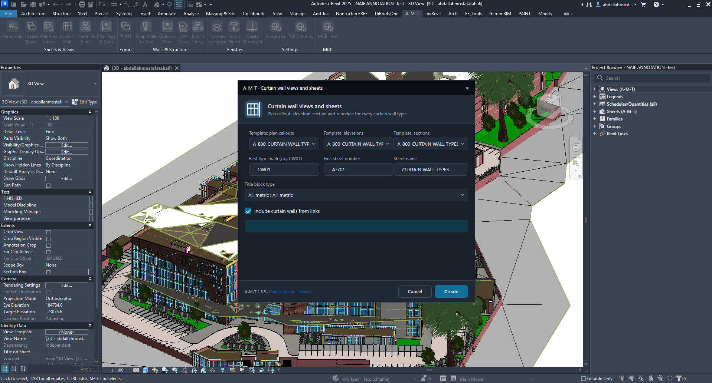
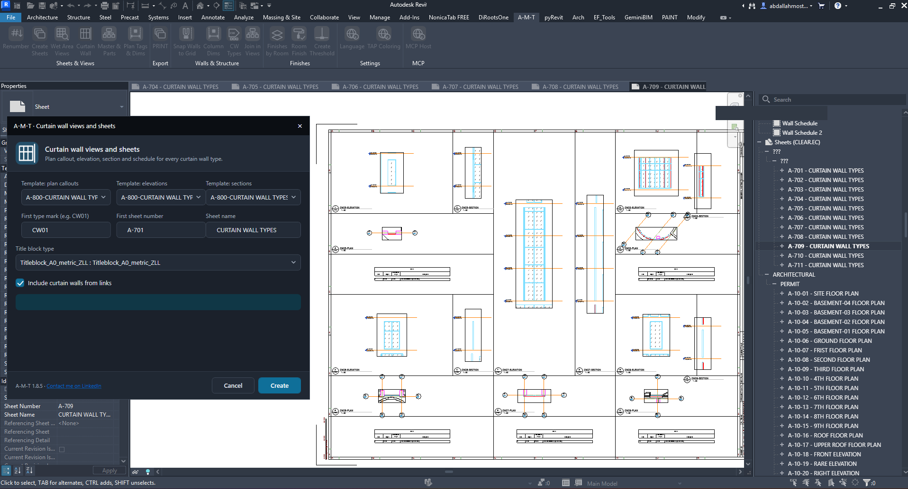
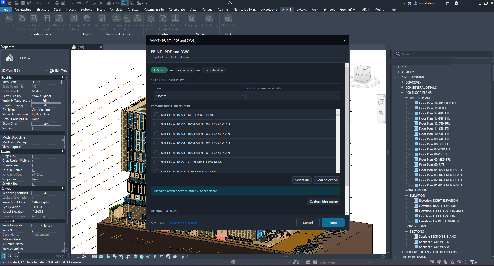
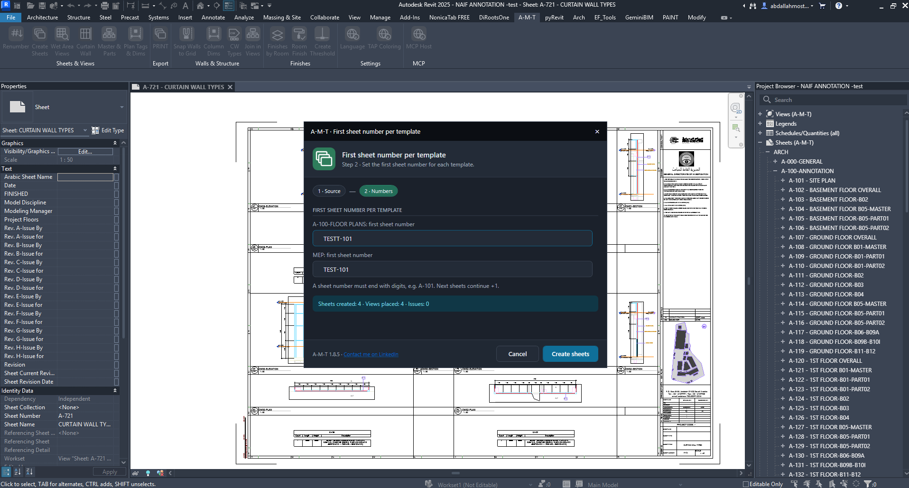
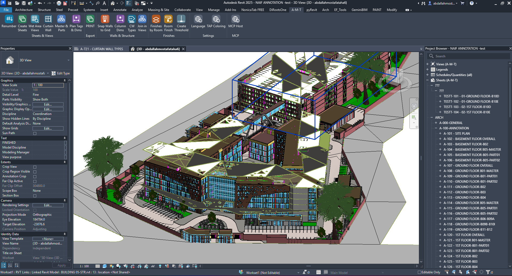
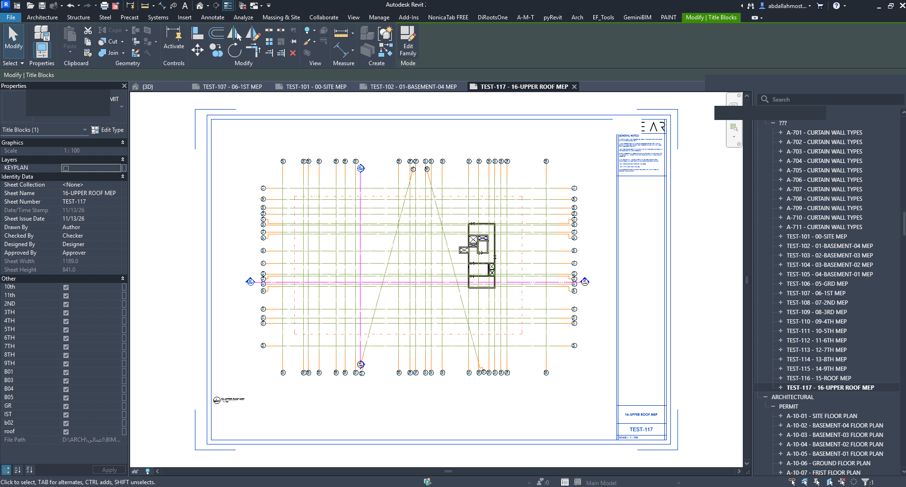
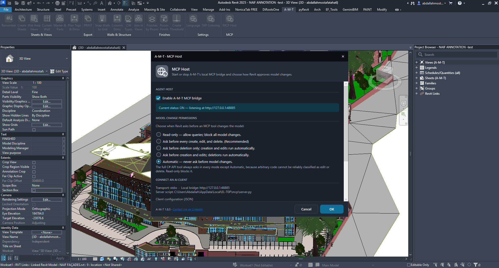
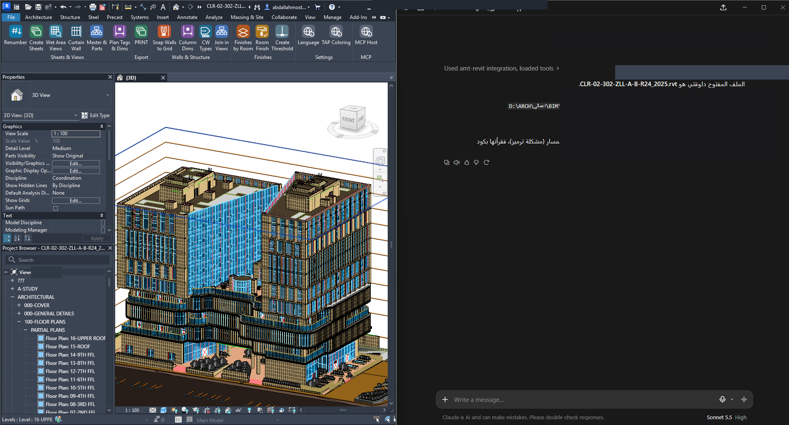

  

<h1 align="center">A-M-T</h1>

  <strong>Architectural Modeling Toolkit</strong>

  One Toolkit. Smarter BIM Workflows.

  A Revit add-in designed to streamline architectural modelling,
  documentation, and everyday BIM production tasks.

---

## Features

### Modeling & Automation
- Renumber
- Create Sheets
- Wet Area Views
- Curtain Wall
- Master & Parts
- Snap Walls to Grid
- CW Types
- Join in Views

### Documentation & Productivity
- Plan Tags & Dims
- Print
- Column Dims
- Finishes by Room
- Room Finish
- Create Threshold
- Language
- TAP Coloring

### AI Integration
- MCP Host
- Connect supported AI clients to Revit through a local MCP bridge.

---

## A-M-T in Action

Explore A-M-T's interface, automation tools, and real-world Revit workflows.

### Main Interface

  

---

### Curtain Wall Automation

Automate curtain wall views, elevations, sections, and sheet documentation.

**1. Configure Curtain Wall Settings**

  

**2. Generated Documentation – Final Result**

  

---

### Print – PDF & DWG

Export drawing sheets and views to PDF or DWG.

  

---

### Create Sheets Automation

Automatically create sheets and arrange selected views.

**1. Configure Sheet Numbering**

  

**2. Execution Result**

  

**3. Generated Revit Sheet**

  

---

### AI & MCP Integration

Connect supported AI clients to Revit through the A-M-T local MCP bridge.

**MCP Host Configuration**

  

**AI-Assisted Revit Workflow**

  

---

## Documentation

Explore the official A-M-T user guides.

| Documentation | Description |
|---|---|
| [Quick User Guide](Documentation/AMT_1.8.8_Quick_Guide.pdf) | Overview of A-M-T tools |
| [Individual Command Guides](Documentation/Command-Guides/) | Detailed guides for all 17 commands |

---

## Installation

1. Open the [Latest Release](../../releases/latest).
2. Download `A-M-T-Setup-1.8.8.exe`.
3. Run the installer.
4. Follow the installation instructions.
5. Launch Autodesk Revit and start using A-M-T.

---

## Release Information

| Item | Details |
|---|---|
| Product | A-M-T |
| Version | 1.8.8 |
| Platform | Windows |
| Application | Autodesk Revit |
| Distribution | Private |

---

## Developer

**Abdullah Mostafa**

Architectural Engineer | BIM Architect | Revit & Dynamo Automation

## Contact

- **LinkedIn:** [Connect with me](https://www.linkedin.com/in/abdallah-m0stafa/)
- **GitHub:** [A-M-T Repository](../../)

---

  <strong>A-M-T — Model. Document. Automate.</strong>

